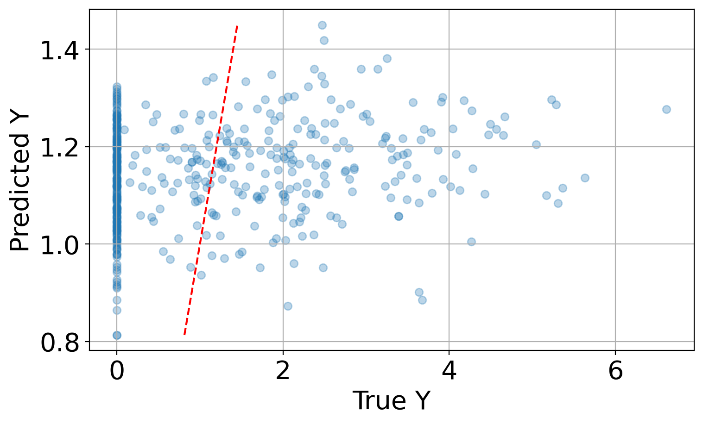
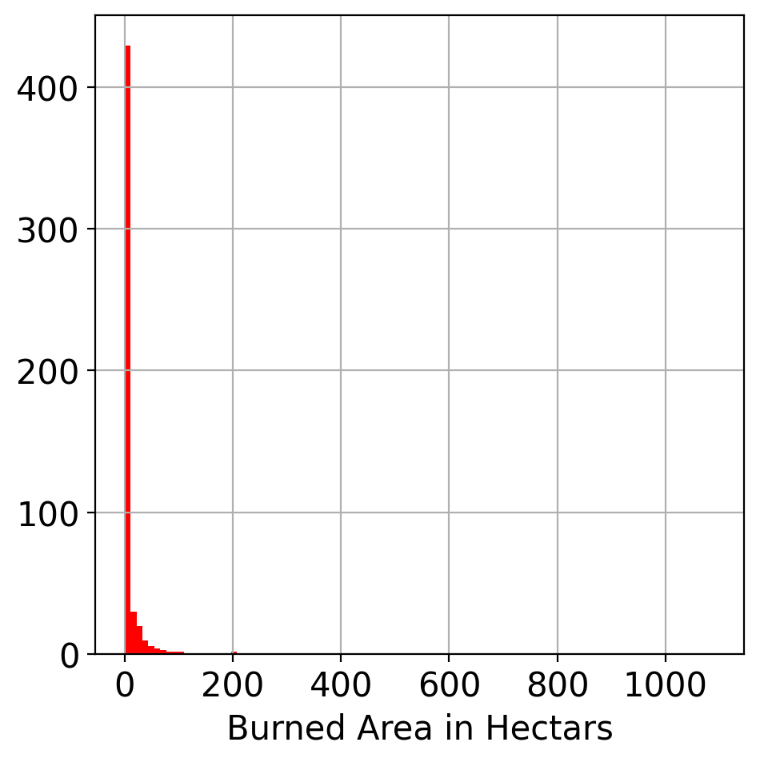
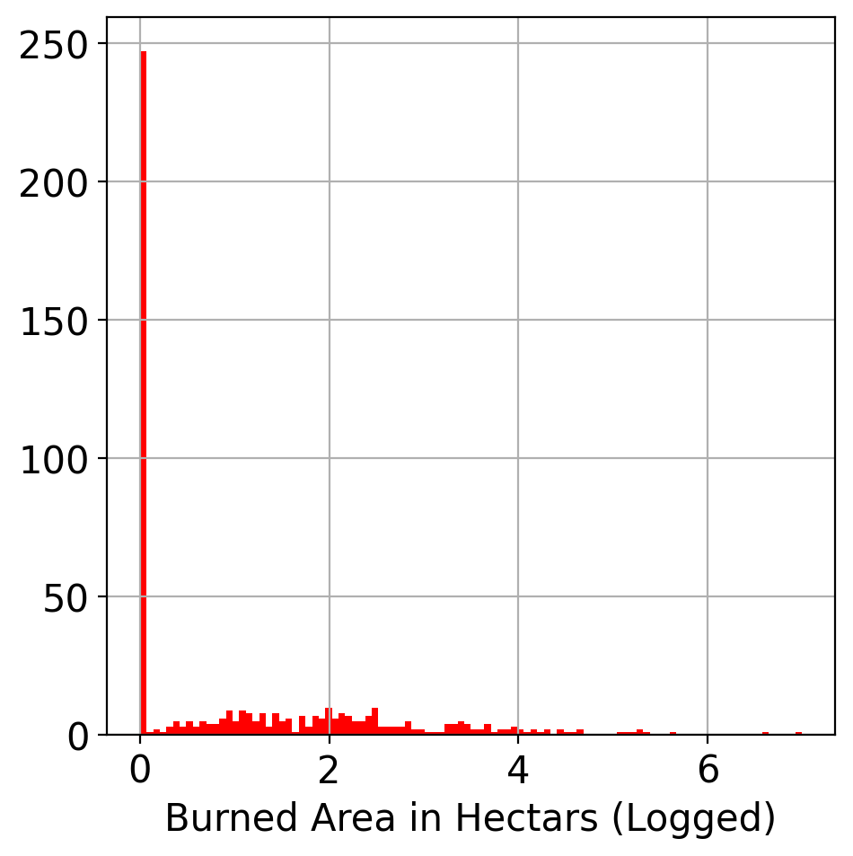
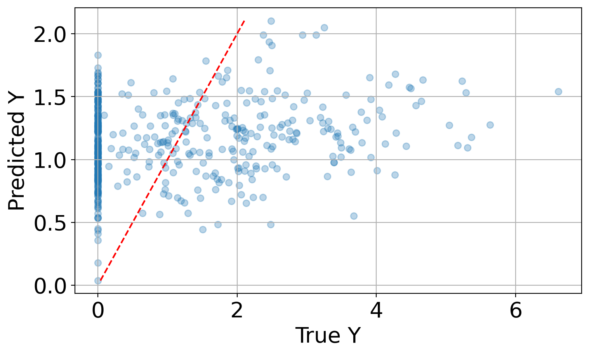
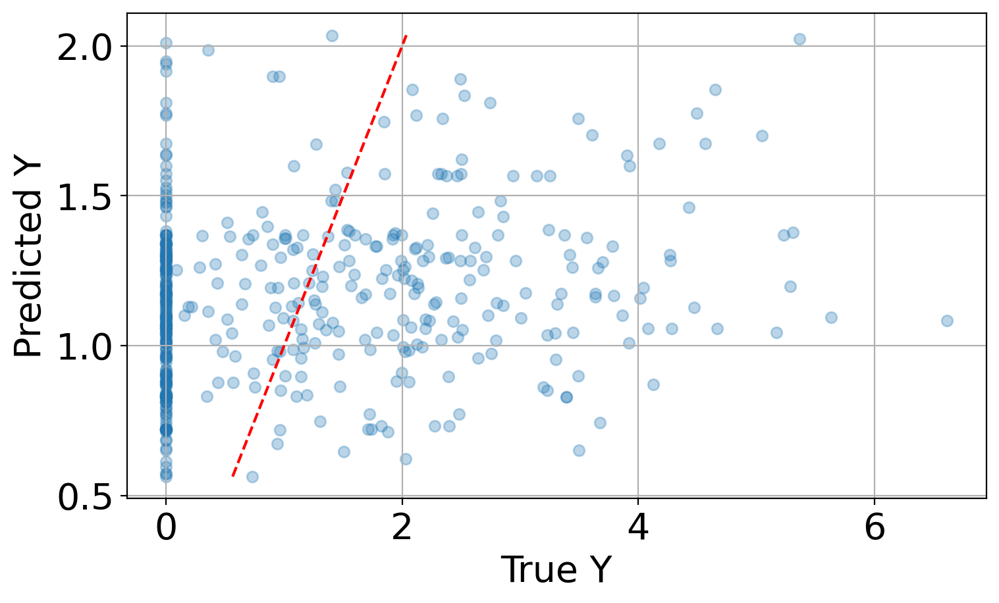
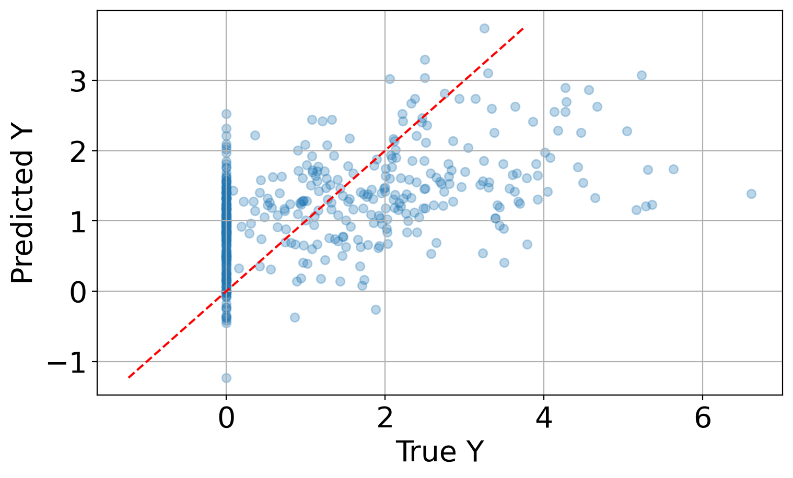
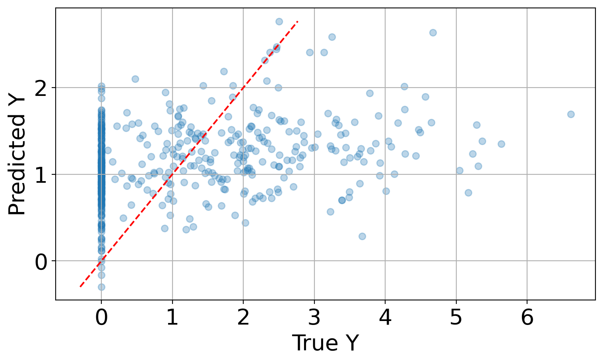

# Predicting Forest Fire Burned Area with Regression

A comparison of linear, ridge, KNN, polynomial and cubic spline regression for predicting the area burned by forest fires in Portugal's Montesinho Natural Park from weather and Fire Weather Index data, tuned with leave-one-out cross-validation.

Course project for **CM 764 Statistical Learning: Advanced Regression** (cross-listed as STAT 844, University of Waterloo, Spring 2025), by Xin Ming Li.

## Results at a glance



Ridge regression predictions vs. true values on the training set (log scale). A perfect model would put every point on the red 45° line.

| Model | Tuned hyperparameter | LOO-CV MSE (log scale) |
|---|---|---|
| Linear regression | none | 2.1066 |
| K-nearest neighbours | k = 30 | 1.9714 |
| **Ridge regression** | **α = 756.46** | **1.9406** |
| Polynomial regression | degree d = 2 | 3.7513 |
| Cubic spline | τ = 2 knots | 2.0640 |
| Cubic spline with a ridge penalty | τ = 2 knots, α = 12.62 | 1.9581 |

- **Ridge regression had the lowest cross-validated error**, with KNN close behind.
- **No model predicts burned area accurately.** All of them do worst on fires with little or no burned area, which are the most common case.

## Setup

### 1. Requirements

- Python 3.12. The version requirements in `requirements.txt` are for this version of Python. Newer versions may yield slightly different numbers.

### 2. Create a virtual environment

Run these from the folder that contains `forest_fire_regression.ipynb`.

Windows (PowerShell):

```powershell
python -m venv .venv
.venv\Scripts\Activate.ps1
```

macOS / Linux:

```bash
python3 -m venv .venv
source .venv/bin/activate
```

### 3. Install the libraries

```bash
pip install -r requirements.txt
```

### 4. Get the data

Nothing to download by hand. The first code cell loads the [Forest Fires dataset](https://archive.ics.uci.edu/dataset/162/forest+fires) (UCI id 162, 517 fires from 2000 to 2003) with `ucimlrepo`:

```python
from ucimlrepo import fetch_ucirepo
forest_fires = fetch_ucirepo(id=162)
```

No data files are stored in this repository.

## Data

The [Forest Fires dataset](https://archive.ics.uci.edu/dataset/162/forest+fires) (Cortez and Morais, 2007) records 517 forest fires in the Montesinho Natural Park in northeast Portugal, from January 2000 to December 2003. The park has a supra-Mediterranean climate with an average annual temperature between 8 °C and 12 °C.

The data came from two sources. The fire inspector responsible for Montesinho recorded the date, location, Fire Weather Index (FWI) components and burned area of each fire. The Bragança Polytechnic Institute added weather readings from a station at the centre of the park.

| Attribute | Description |
|---|---|
| X, Y | Location on a 9 × 9 grid over the park map (1 to 9) |
| month | Month of the year (January to December) |
| day | Day of the week (Monday to Sunday) |
| FFMC | Fine Fuel Moisture Code |
| DMC | Duff Moisture Code |
| DC | Drought Code |
| ISI | Initial Spread Index |
| temp | Outdoor temperature (°C) |
| RH | Outdoor relative humidity (%) |
| wind | Outdoor wind speed (km/h) |
| rain | Outdoor rain (mm/m²) |
| **area** | **Total burned area (ha), the target** |

FFMC, DMC, DC and ISI come from the [Canadian Forest Fire Weather Index System](https://cwfis.cfs.nrcan.gc.ca/background/summary/fwi):

- **FFMC** rates the moisture content of litter and other fine fuels.
- **DMC** rates the moisture of loosely compacted organic layers of moderate depth.
- **DC** rates the moisture of deep, compact organic layers.
- **ISI** rates the expected rate of fire spread, based on wind speed and FFMC.

The system's other two components, the Buildup Index (BUI) and the FWI itself, are not in the dataset because they are computed from the four above.

## Method

### Feature engineering

- **Cyclical encoding.** Month and day of week are mapped to integers and then replaced by sine and cosine columns, $\sin(2\pi m/12)$ and $\cos(2\pi m/12)$ for month $m$, and $\sin(2\pi d/7)$ and $\cos(2\pi d/7)$ for day of week $d$. This tells the models that December is next to January and Sunday is next to Monday.
- **Log transform of the target.** Burned area is heavily right-skewed, so every model predicts $\log(\text{area} + 1)$ instead.

| Burned area | Burned area after the log transform |
|---|---|
|  |  |

### Training and tuning

- The data is split at random into a training set (465 fires) and a held-out test set (52 fires, about 10%). Only the training set is used for fitting and tuning.
- Each model is scored by mean squared error (MSE) with leave-one-out cross-validation (LOO-CV). Ridge regression uses generalized cross-validation, which gives the same leave-one-out error far more cheaply.
- Hyperparameters tried:
  - **KNN:** number of neighbours k = 2, 4, ..., 48.
  - **Ridge:** 100 values of the penalty α, log-spaced from 10⁻¹ to 10¹⁵, on standardized features.
  - **Polynomial:** degree d = 2, 3, 4.
  - **Cubic spline:** τ = 2 to 9 knots, then 10 to 100 in steps of 10. Knots are placed at quantiles of each feature so each one covers a similar share of the data.

## Discussion

| Linear regression | KNN |
|---|---|
|  |  |
| **Polynomial regression** | **Cubic spline** |
|  |  |

- **KNN does surprisingly well.** It is a local model, so it is less affected by the skewed target than the global models.
- **Every model misses fires with little or no burned area.** In the predicted-vs-true plots, fires that burned almost nothing still get predictions well above zero.
- **The models' assumptions are likely wrong for this data.** Linear and ridge regression assume a smooth linear relationship, and polynomial and spline models assume a smooth curve. The high errors and the misses at zero suggest the true relationship has abrupt changes.
- **Flexible smooth models overfit.** Polynomial degrees 3 and 4 have LOO-CV errors in the thousands, and spline errors climb from 20 at 30 knots to over a trillion at 50 knots.

### Future work

Tree-based models such as random forests or gradient boosting handle nonlinearity and interactions without assuming smoothness, and are the natural next step, especially for predicting fires with zero burned area.

## References

> Cortez, P. and Morais, A. (2007). Forest Fires [Dataset]. UCI Machine Learning Repository. https://doi.org/10.24432/C5D88D

Introduced in: Cortez, P. and Morais, A. (2007). A Data Mining Approach to Predict Forest Fires using Meteorological Data. In *New Trends in Artificial Intelligence, Proceedings of the 13th EPIA*, pp. 512–523. [RepositóriUM](https://repositorium.sdum.uminho.pt/handle/1822/8039)
